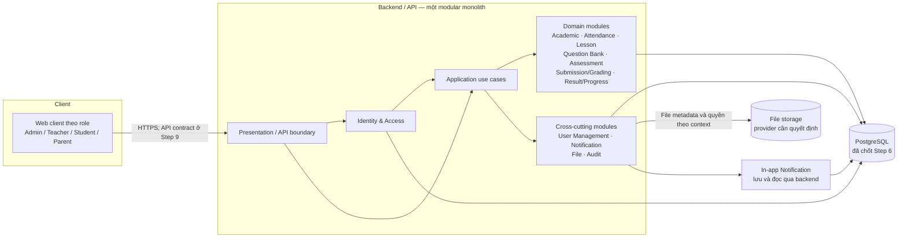

# Sơ đồ kiến trúc tổng thể

Sơ đồ biểu diễn các ranh giới logic V1, không chọn framework, giao thức API, cloud vendor hoặc object storage provider.

## Ghi chú

- Các module backend chạy trong cùng application ở V1; đường nối là dependency logic, không phải network hop.
- File content ở storage abstraction; metadata và `AttachmentLink` nằm trong PostgreSQL. Backend kiểm tra quyền trước khi upload/download.
- Notification V1 được lưu và hiển thị trong ứng dụng; không có external email/SMS provider trong kiến trúc đã chốt.
- Permission/data scope từ Step 7 được áp dụng trong backend trên mọi đường truy cập dữ liệu, kể cả file và notification context.
