# ERD tổng thể

Sơ đồ thể hiện các entity nghiệp vụ chính và một số entity hỗ trợ. Các quan hệ M:N được tách thành entity nối. `AssessmentVersion` là snapshot phát hành; `AssessmentQuestion` là câu hỏi snapshot trong phiên bản đó.

```mermaid
erDiagram
  USER ||--o{ USER_ROLE : has
  ROLE ||--o{ USER_ROLE : assigned
  PERSON_PROFILE o|--o| USER : account
  PERSON_PROFILE ||--o{ USER_PERSON_PROFILE_HISTORY : account_history
  USER ||--o{ USER_PERSON_PROFILE_HISTORY : account_changes
  PERSON_PROFILE ||--o{ STUDENT : learner_profile
  PERSON_PROFILE ||--o{ PARENT : parent_profile
  PERSON_PROFILE ||--o{ TEACHER : teacher_profile
  PARENT ||--o{ PARENT_STUDENT_RELATIONSHIP : links
  STUDENT ||--o{ PARENT_STUDENT_RELATIONSHIP : linked
  SUBJECT ||--o{ LEARNING_CLASS : classifies
  STUDENT ||--o{ CLASS_MEMBER : joins
  LEARNING_CLASS ||--o{ CLASS_MEMBER : includes
  TEACHER ||--o{ TEACHER_CLASS_ASSIGNMENT : assigned
  LEARNING_CLASS ||--o{ TEACHER_CLASS_ASSIGNMENT : staffed
  LEARNING_CLASS ||--o{ SCHEDULE : plans
  SCHEDULE ||--o{ SCHEDULE_HISTORY : revisions
  SCHEDULE o|--o{ LESSON_SESSION : generates
  LEARNING_CLASS ||--o{ LESSON_SESSION : holds
  LESSON_SESSION ||--o{ ATTENDANCE_RECORD : records
  STUDENT ||--o{ ATTENDANCE_RECORD : attends
  PARENT ||--o{ ABSENCE_EXPLANATION : submits
  ATTENDANCE_RECORD o|--o{ ABSENCE_EXPLANATION : concerns
  SUBJECT ||--o{ QUESTION : classifies
  QUESTION_BANK ||--o{ QUESTION : contains
  QUESTION ||--o{ QUESTION_VERSION : versions
  QUESTION_VERSION ||--o{ QUESTION_OPTION : offers
  QUESTION_VERSION ||--o{ QUESTION_TOPIC : tagged
  TOPIC ||--o{ QUESTION_TOPIC : classifies
  QUESTION_VERSION ||--o{ QUESTION_TAG : tagged
  TAG ||--o{ QUESTION_TAG : classifies
  ASSESSMENT ||--o{ ASSESSMENT_VERSION : versions
  ASSESSMENT_VERSION ||--o{ ASSESSMENT_AUDIENCE : targets
  LEARNING_CLASS o|--o{ ASSESSMENT_AUDIENCE : receives
  STUDENT o|--o{ ASSESSMENT_AUDIENCE : receives
  ASSESSMENT_VERSION ||--o{ ASSESSMENT_QUESTION : contains
  QUESTION_VERSION o|--o{ ASSESSMENT_QUESTION : source
  ASSESSMENT ||--o{ STUDENT_ASSESSMENT : eligible
  STUDENT ||--o{ STUDENT_ASSESSMENT : assigned
  STUDENT_ASSESSMENT ||--o{ ATTEMPT : allows
  ASSESSMENT_VERSION ||--o{ ATTEMPT : fixed_version
  ATTEMPT ||--o{ ATTEMPT_QUESTION : presents
  ASSESSMENT_QUESTION ||--o{ ATTEMPT_QUESTION : selected
  ATTEMPT ||--o{ ANSWER : saves
  ASSESSMENT_QUESTION ||--o{ ANSWER : answered
  ATTEMPT ||--o| SUBMISSION : finalizes
  SUBMISSION ||--o{ GRADE : graded
  GRADE ||--o{ GRADE_HISTORY : changes
  SUBMISSION ||--o{ FEEDBACK : receives
  FEEDBACK ||--o{ FEEDBACK_HISTORY : changes
  SUBMISSION ||--o| RESULT : summarizes
  RESULT ||--o{ RESULT_HISTORY : changes
  RESULT ||--o| RESULT_PUBLICATION : publishes
  USER ||--o{ ATTACHMENT : owns
  USER ||--o{ NOTIFICATION : receives
  NOTIFICATION ||--o{ NOTIFICATION_CONTEXT : links
  ASSESSMENT o|--o{ NOTIFICATION_CONTEXT : context
  LESSON_SESSION o|--o{ NOTIFICATION_CONTEXT : context
  RESULT o|--o{ NOTIFICATION_CONTEXT : context
  SCHEDULE o|--o{ NOTIFICATION_CONTEXT : context
  USER ||--o{ AUDIT_LOG : acts
```

**Lưu ý:** `StudentAssessment` là đối tượng giao hiệu lực duy nhất cho một Student và Assessment, hợp nhất nguồn nhận từ Class/direct assignment để không tạo bài trùng. Attendance history được lưu riêng ngoài ERD rút gọn. Tệp có thể liên kết nhiều ngữ cảnh qua bảng nối `AttachmentLink`.
